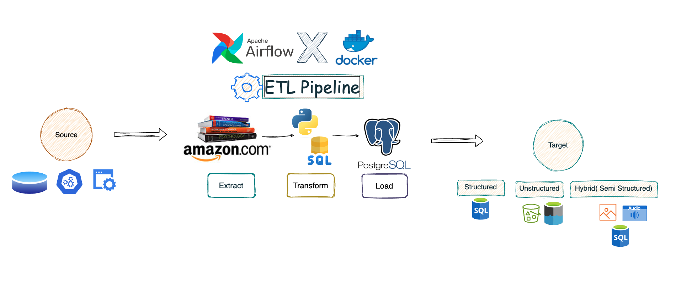

# ETL Pipeline for Amazon Books Data

[](https://airflow.apache.org/)
[](https://www.postgresql.org/)
[](https://docs.docker.com/compose/)
[](https://www.python.org/)

A comprehensive ETL (Extract, Transform, Load) pipeline that automatically scrapes book data from Amazon, processes it, and stores it in a PostgreSQL database using Apache Airflow for orchestration.

## 🚀 Quick Start

```bash
# Clone the repository
git clone https://github.com/marun224/ETL_Pipeline_Airflow.git
cd ETL_Pipeline_Airflow

# Start the services
docker-compose up airflow-init
docker-compose up -d

# Access Airflow Web UI
open http://localhost:8080
```

**Default Credentials:**
- Airflow: `airflow` / `airflow`
- PGAdmin: `admin@admin.com` / `root`

## 📋 Features

- **Automated Data Extraction**: Scrapes Amazon book data using web scraping
- **Data Transformation**: Cleans and processes data using Pandas
- **Database Storage**: Stores structured data in PostgreSQL
- **Workflow Orchestration**: Uses Apache Airflow for scheduling and monitoring
- **Web Interface**: Airflow UI for pipeline monitoring and PGAdmin for database management
- **Containerized Deployment**: Full Docker Compose setup for easy deployment
- **Scalable Architecture**: Celery executor for distributed processing

## 🏗️ Architecture



The pipeline follows a standard ETL pattern:

1. **Extract**: Scrape book data from Amazon search results
2. **Transform**: Clean and structure data using Python/Pandas
3. **Load**: Insert processed data into PostgreSQL database

### Core Components

- **Apache Airflow**: Workflow orchestration and scheduling
- **PostgreSQL**: Primary database for data storage
- **PGAdmin**: Database administration interface
- **Redis**: Message broker for Celery workers
- **Docker**: Containerization and deployment

## 📊 Data Pipeline

### DAG Structure
```
fetch_book_data → create_table → insert_book_data
```

### Data Schema
```sql
CREATE TABLE books (
    id SERIAL PRIMARY KEY,
    title TEXT NOT NULL,
    authors TEXT,
    price TEXT,
    rating TEXT
);
```

## 🛠️ Setup and Installation

### Prerequisites
- Docker (20.10+)
- Docker Compose (1.29+)
- 4GB+ RAM
- 10GB+ disk space

### Detailed Setup
For comprehensive setup instructions, see [SETUP.md](SETUP.md)

### Architecture Details
For detailed architecture information, see [ARCHITECTURE.md](ARCHITECTURE.md)

## 🔧 Configuration

### Airflow Connection Setup
1. Navigate to Airflow UI → Admin → Connections
2. Create new connection:
   - **Connection Id**: `books_connection`
   - **Connection Type**: `Postgres`
   - **Host**: `postgres`
   - **Schema**: `airflow`
   - **Login**: `airflow`
   - **Password**: `airflow`

### Environment Variables
The `.env` file contains necessary configuration:
```
AIRFLOW_UID=197609
```

## 📈 Monitoring

### Airflow Web UI (http://localhost:8080)
- Monitor DAG execution status
- View task logs and performance
- Trigger manual pipeline runs
- Configure scheduling and alerts

### PGAdmin (http://localhost:5050)
- Query and analyze book data
- Monitor database performance
- Manage schemas and users

## 🔍 Usage

1. **Enable the DAG**: Toggle the `fetch_and_store_amazon_books` DAG in Airflow UI
2. **Manual Trigger**: Click "Trigger DAG" for immediate execution
3. **Scheduled Runs**: Pipeline runs daily by default
4. **Monitor Progress**: View real-time execution in Airflow UI
5. **Query Data**: Use PGAdmin to analyze collected book data

## 📝 Development

### Adding New Features
1. Modify `dags/app.py` for pipeline logic changes
2. Add new dependencies to `requirements.txt`
3. Restart services: `docker-compose restart`

### Custom DAGs
Place new DAG files in the `dags/` directory for automatic detection.

## 🚨 Troubleshooting

### Common Issues
- **Port Conflicts**: Ensure ports 8080, 5432, 5050 are available
- **Memory Issues**: Increase Docker memory allocation
- **Connection Errors**: Verify PostgreSQL connection settings

### Logs
```bash
# View all logs
docker-compose logs

# View specific service logs
docker-compose logs airflow-webserver
```

## 🔒 Security

- Change default passwords in production
- Use environment variables for sensitive data
- Implement proper network security
- Regular security updates

## 📄 License

This project is open source and available under the [MIT License](LICENSE).

## 🤝 Contributing

1. Fork the repository
2. Create a feature branch
3. Make your changes
4. Submit a pull request

## 📞 Support

For questions or issues, please open an issue in the GitHub repository.

---

**Built with ❤️ using Apache Airflow, PostgreSQL, and Docker**


